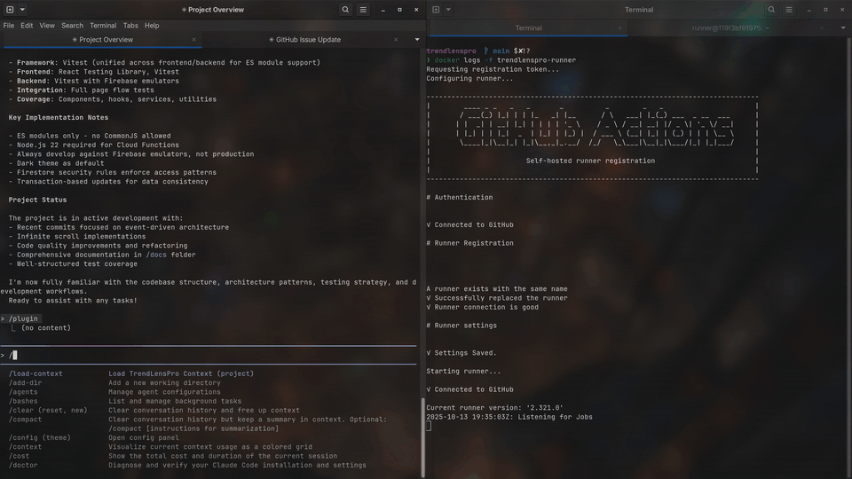

# techLEAD

### **L**eadership **E**ngine for **A**I **D**evelopment

**Autonomous project orchestration powered by Claude Code**

[](https://opensource.org/licenses/MIT)
[](https://github.com/Lucasmind/techLEAD)
[](https://github.com/Lucasmind/techLEAD/stargazers)



> **See techLEAD in action**: Watch as it autonomously analyzes issues, coordinates GitHub Actions runners, builds comprehensive tests, manages code reviews, and delivers high-quality code - all while you focus on strategic decisions.

---

## A Quick Note

Hey! I built this for myself to speed up my own coding workflow. It's been working great for me, so I figured I'd share it. I'll update it sporadically as I need new features or find issues, but I'm not looking to heavily support or maintain this as a big project.

That said—if you spot problems, open an issue. Got a good idea? Open an issue. Fork it, modify it, make it your own. It's completely open and not particularly complex, but it seems to work pretty well.

Good vibes to you! ✌️

---

## Security & Usage Notes

**Intended Use Case**: techLEAD works best as a **personal development tool** or with a **small trusted team in a private repository**. It's not designed for large open-source projects with many external contributors.

**Why?** techLEAD triggers on GitHub issue comments and titles (like `@claude`). In an open repo, anyone can create issues or comments, which could be a security concern. In a personal or private team repo, you control who has access, so you're only triggering automation on content you trust.

**For Full Autonomy**: To get the most out of techLEAD's autonomous workflows without constant permission prompts, consider running Claude Code with the `--dangerously-skip-permissions` flag when using the `/techlead:techlead` command:

```bash
# Add to your Claude Code launch or settings
claude-code --dangerously-skip-permissions
```

⚠️ **Note**: This flag allows Claude to execute commands without asking permission each time. Only use this in repositories you trust and own. This is what makes techLEAD truly autonomous - it can coordinate GitHub runners, create PRs, run tests, and merge without interrupting you for every action.

**Bottom line**: If you're the only one (or working with a small trusted team) on your repo, techLEAD is safe and powerful. If you're running a public open-source project with external contributors, you'll want to be more cautious about who can trigger @claude automation.

---

## Overview

techLEAD is an AI-powered technical leader that autonomously manages software development workflows. Built natively on Claude Code, it makes strategic decisions, coordinates GitHub Actions runners, and ensures high-quality code delivery.

### What techLEAD Does

- ✅ **Analyzes and prioritizes issues** based on project context
- ✅ **Coordinates implementation** via @claude GitHub Actions runner
- ✅ **Builds comprehensive tests** using test-builder subagent
- ✅ **Manages code review** with @claude-review integration
- ✅ **Validates quality** before merge with final-validator
- ✅ **Maintains project memory** and learns from patterns

### What techLEAD Doesn't Do

- ❌ **Write implementation code** (delegates to @claude runner)
- ❌ **Make decisions without PM approval** (checkpoints at key decisions)
- ❌ **Modify production without validation** (comprehensive pre-merge checks)

---

## Use Cases

techLEAD excels in scenarios where autonomous coordination and quality assurance are critical:

### 🚀 Solo Developer Velocity
**Perfect for:** Individual developers managing their own projects
- Analyze and prioritize your backlog of issues
- Delegate implementation to @claude runner while you focus on architecture
- Automatic test generation with 80%+ coverage
- Code review and quality checks before every merge
- **Result:** Ship features 3-5x faster with better quality

### 👥 Small Team Coordination
**Perfect for:** 2-5 person teams working on private repositories
- Consistent development workflow across team members
- Automated code review catches issues before human review
- Comprehensive testing reduces QA burden
- Built-in rollback checkpoints for safe experimentation
- **Result:** Maintain high quality standards without slowing down

### 🔄 Large Refactoring Projects
**Perfect for:** Technical debt cleanup or architecture changes
- Multi-issue sequences for related refactoring work
- Checkpoint system allows easy rollback if approach fails
- Automated testing prevents regressions
- Review ensures refactoring doesn't change behavior
- **Result:** Safely modernize codebase without breaking features

### ⚡ Rapid Prototyping
**Perfect for:** Validating ideas quickly
- Quick issue creation with `/techlead:techlead-issue`
- Autonomous implementation and testing
- Fast iteration with rollback protection
- Memory system learns your patterns
- **Result:** Validate 5-10 ideas per day instead of 1-2

---

## Quick Start

Ready to try techLEAD? Get started in 5 minutes:

### Prerequisites
- [Claude Code](https://claude.com/claude-code) installed
- Git installed
- GitHub repository (public or private)

### Installation (3 steps)

1. **Open your project** in Claude Code:
   ```bash
   cd /path/to/your-project
   claude
   ```

2. **Install the plugin:**
   - Type `/plugin` and select **"Add marketplace"**
   - Enter: `https://github.com/Lucasmind/techLEAD`
   - Select **techlead-marketplace** from the list
   - Install the **techlead** plugin

3. **Complete setup:**
   ```bash
   /techlead:techlead-setup
   ```

   This creates the `.techlead/` directory with monitoring scripts, templates, and configuration.

4. **Set up GitHub Actions** (one-time):
   - Follow [Claude's GitHub Actions guide](https://docs.claude.com/en/docs/claude-code/github-actions)
   - Or use `/install-github-app` in Claude Code
   - For self-hosted runners: Add runner with label `techlead`

**That's it!** Run `/techlead:techlead` to start orchestrating.

**💡 Tip**: For full autonomy without permission prompts, launch Claude Code with `--dangerously-skip-permissions` flag (only in repos you trust).

---

## How It Works: A Typical Workflow

Here's what a day with techLEAD looks like, whether you're starting a new project or working on an existing codebase.

### 1. Planning Your Work

**Create issues with AI assistance:**
```bash
You: /techlead:techlead-issue

Claude: What would you like to create an issue for?

You: Add user authentication with JWT tokens

Claude: [Detects: Feature, Security-relevant]
Let me help you create a comprehensive feature issue...

[Conversational extraction of requirements]

✓ Issue #42 created: Add JWT authentication
  Labels: enhancement, security
  Related: Issue #38 (API endpoints)
```

**Benefits:**
- Consistent issue formatting across your team
- No forgotten requirements or edge cases
- Automatic linking of related work
- Testing requirements excluded (techLEAD handles this)

### 2. Starting Work

**Initialize techLEAD:**
```bash
You: /techlead:techlead

techLEAD: Checking for in-progress work... None found.

Found 5 open issues:
  #42 [enhancement, security] Add JWT authentication
  #43 [bug] Login form validation error
  #44 [enhancement] Add rate limiting
  ...

Would you like to:
  a) Work on a single issue
  b) Work on a sequence (multiple related issues)

You: Work on issue 42

techLEAD: Creating checkpoint: before-issue-42
Analyzing issue #42...

[Classifies as: Security Feature]
[Loads: security-fix.md guidance template]
[Populates with: requirements, affected files, patterns]

Ready to post guidance to @claude runner. Proceed? (yes/no)

You: yes
```

### 3. Autonomous Execution

**techLEAD orchestrates the workflow:**

```
techLEAD: ✓ Posted @claude comment with structured guidance
          ⏳ Monitoring implementation (blocking)...

[GitHub Actions runner starts in background]
@claude: Creating branch: issue-42-add-jwt-authentication
@claude: Installing dependencies...
@claude: Implementing JWT middleware...
@claude: Adding authentication routes...
@claude: ✓ Implementation complete

techLEAD: ✓ Implementation succeeded (12 minutes)
          Synchronizing local branch...
          ✓ Branch synced: issue-42-add-jwt-authentication

          Spawning test-builder subagent...

test-builder: Analyzing implementation changes...
test-builder: Found: AuthMiddleware, JWTService, AuthController
test-builder: Creating unit tests... ✓
test-builder: Creating integration tests... ✓
test-builder: Running tests... ✓ (coverage: 87%)
test-builder: Committing tests... ✓

techLEAD: ✓ Tests complete
          Creating pull request...

✓ PR #123 created: Add JWT authentication
  Auto-triggered @claude-review...
```

### 4. Code Review Loop

**Automated review and iteration:**

```
techLEAD: ⏳ Monitoring code review (blocking)...

@claude-review: Analyzing PR #123...
@claude-review: Found 3 issues:
  - CRITICAL: JWT secret hardcoded in middleware
  - IMPORTANT: Missing token expiration check
  - OPTIONAL: Consider using refresh tokens

techLEAD: ✓ Review complete
          Spawning code-analyzer subagent...

code-analyzer: Categorized feedback:
  🔴 CRITICAL (1): Security vulnerability
  🟡 IMPORTANT (1): Missing functionality
  ⚪ OPTIONAL (1): Enhancement suggestion

  Priority: Fix critical and important items
  Estimated time: 15 minutes

techLEAD: Posting fix request to @claude runner...
          ⏳ Monitoring implementation (blocking)...

@claude: Fixing issues...
@claude: - Moved JWT secret to environment variable
@claude: - Added token expiration validation
@claude: ✓ Fixes pushed

techLEAD: ✓ Fixes complete
          ⏳ Waiting for re-review (blocking)...

@claude-review: Re-analyzing PR #123...
@claude-review: ✓ All critical issues resolved
@claude-review: ✓ Approved for merge

techLEAD: ✓ Review clean (no changes requested)
```

### 5. Pre-Merge Validation

**Comprehensive quality checks:**

```
techLEAD: Spawning final-validator subagent...

final-validator: Running pre-merge validation...
final-validator: ✓ Unit tests passing (87% coverage)
final-validator: ✓ Integration tests passing
final-validator: ✓ Linting passed
final-validator: ✓ Build successful
final-validator: ✓ E2E tests passing (Playwright)
final-validator: ✓ GitHub checks passing

techLEAD: ✓ All validations passed

Ready to merge PR #123. Approve? (yes/no)

You: yes
```

### 6. Completion & Memory

**Merge and checkpoint:**

```
techLEAD: Merging PR #123... ✓
          Closing issue #42... ✓
          Creating checkpoint: after-issue-42
          Updating project memory...

✓ Issue #42 completed successfully
  - Implementation: 12 minutes
  - Testing: 8 minutes
  - Review & fixes: 15 minutes
  - Total: 35 minutes

Updated CLAUDE.md with learned patterns:
  - JWT authentication implementation
  - Environment variable pattern
  - Token expiration best practices

Continue with next issue? (yes/no)
```

### Key Interactions Explained

**techLEAD (Orchestrator)**
- Lives in your Claude Code session
- Makes strategic decisions
- Coordinates all actors
- Maintains project memory
- Monitors via Docker logs (self-hosted) or GitHub UI (cloud-hosted)

**@claude (Implementation Runner)**
- GitHub Actions runner (cloud or self-hosted)
- Receives structured guidance from techLEAD
- Writes implementation code
- Creates branches and commits
- Responds to fix requests

**@claude-review (Code Review Runner)**
- Auto-triggered on PR creation
- Analyzes code quality and security
- Categorizes issues by severity
- Re-reviews after fixes

**Subagents (Local)**
- `test-builder`: Creates comprehensive tests following project patterns
- `code-analyzer`: Interprets review feedback, prioritizes actions
- `final-validator`: Pre-merge quality gate (tests, linting, builds, E2E)

**Monitoring (Self-Hosted Runners)**

With self-hosted runners, techLEAD monitors jobs in real-time via Docker logs:

```bash
# Automatically called by techLEAD during workflow
.techlead/monitor.sh implement  # Watches @claude implementation
.techlead/monitor.sh review     # Watches @claude-review
.techlead/monitor.sh test       # Watches @claude-test
```

**How monitoring works:**
```
techLEAD posts @claude comment
  ↓
Runs: .techlead/monitor.sh implement (BLOCKS until complete)
  ↓
Script tails: docker logs -f <container>
  ↓
Detects: "Running job: claude" → "Job completed: Succeeded"
  ↓
Exits with code 0 (success) or 1 (failure)
  ↓
techLEAD continues workflow automatically
```

**Benefits:**
- ✅ Real-time visibility into job progress
- ✅ No polling overhead or API rate limits
- ✅ Guaranteed workflow continuation
- ✅ Works offline with local runners
- ✅ Essential for fully autonomous operation

This is why self-hosted runners are recommended for the full techLEAD experience.

### Working in Sprints

**Multi-issue sequences:**

```bash
You: /techlead:techlead

techLEAD: Found 5 related issues tagged 'auth-sprint':
  #42 JWT authentication
  #44 Rate limiting
  #45 Session management

Work as sequence? (yes/no)

You: yes

techLEAD: Creating sequence checkpoint: before-seq-auth-sprint-20251009

          Sequence plan:
            1. Issue #42 - JWT authentication (estimated: 40 min)
            2. Issue #44 - Rate limiting (estimated: 30 min)
            3. Issue #45 - Session management (estimated: 25 min)

          I'll proceed autonomously through all issues.
          You'll see progress via checklist updates.
          I'll only stop for failures or critical decisions.

          Proceed? (yes/no)

You: yes

techLEAD: [Autonomously executes all 3 issues]

✓ Sequence complete (95 minutes total)
  Creating checkpoint: after-seq-auth-sprint-20251009

All changes merged to main. Authentication sprint complete! 🎉
```

### Rollback Protection

**Safe experimentation:**

If something goes wrong, rollback to any checkpoint:

```bash
You: /techlead:rollback

Claude: Available rollback points:
  - after-issue-42: Keep JWT auth, remove later work
  - before-seq-auth-sprint: Remove entire auth sprint
  - before-issue-42: Remove all auth work

You: Rollback to before-issue-42

Claude: This will:
  ✓ Keep: All work before issue #42
  ✗ Remove: JWT auth, rate limiting, session management

  Force push required. Confirm? (yes/no)

You: yes

Claude: ✓ Rolled back to before-issue-42
        Reopened issues: #42, #44, #45

Ready to start fresh!
```

---

### What Happens When You Run `/techlead:techlead`

1. **Issue Selection**
   - Lists all open issues
   - Analyzes and categorizes
   - Gets your prioritization

2. **Implementation**
   - Posts @claude comment with guidance
   - Monitors runner via Docker logs (blocking)
   - Waits for completion

3. **Testing**
   - Spawns test-builder subagent
   - Creates comprehensive tests
   - Runs and validates

4. **Code Review**
   - Creates PR (auto-triggers @claude-review)
   - Spawns code-analyzer
   - Coordinates fixes

5. **Final Validation**
   - Spawns final-validator
   - Runs full test suite, linting, build
   - Runs E2E tests (Playwright)

6. **Merge**
   - Gets your approval
   - Generates detailed summary
   - Merges and cleans up

---

## Architecture

techLEAD is a **multi-component system** where a main orchestrator coordinates GitHub Actions runners and local subagents to autonomously manage your development workflow.

### System Overview

```
                    ┌─────────────────────────────────────┐
                    │   You (Project Manager)            │
                    │   Issues slash commands             │
                    └──────────────┬──────────────────────┘
                                   │
                    ┌──────────────▼──────────────────────┐
                    │   techLEAD Orchestrator             │
                    │   (Claude Code Session)             │
                    │                                     │
                    │  • Analyzes issues & prioritizes   │
                    │  • Coordinates all actors          │
                    │  • Makes strategic decisions       │
                    │  • Manages workflow state          │
                    └──┬────────┬────────┬────────────────┘
                       │        │        │
       ┌───────────────┘        │        └─────────────────┐
       │                        │                          │
       ▼                        ▼                          ▼
┌──────────────┐      ┌──────────────────┐     ┌─────────────────┐
│ GitHub       │      │ Local Subagents  │     │ Monitor Scripts │
│ Actions      │      │ (Task tool)      │     │ (.techlead/)    │
│              │      │                  │     │                 │
│ @claude      │      │ • test-builder   │     │ • monitor.sh    │
│ @claude-     │      │ • code-analyzer  │     │ • monitor-      │
│  review      │      │ • final-validator│     │   runner.sh     │
└──────────────┘      └──────────────────┘     └─────────────────┘
```

### Slash Commands (Your Interface)

These commands are how you interact with techLEAD:

| Command | What It Does | When To Use |
|---------|--------------|-------------|
| **`/techlead:techlead`** | Starts the main orchestrator - analyzes issues, coordinates implementation, testing, review, and merge | Beginning of work session or when ready to tackle issues |
| **`/techlead:techlead-issue`** | AI-assisted issue creation with automatic classification and template selection | Creating new GitHub issues with structured, comprehensive information |
| **`/techlead:techlead-setup`** | Installs monitoring scripts, templates, hooks, and config files to your project | First-time setup after plugin installation |
| **`/techlead:rollback`** | Interactive rollback to previous checkpoints using git tags | When you need to undo work from one or more issues |

### Key Components

| Component | Purpose | How It Works |
|-----------|---------|--------------|
| **techLEAD Orchestrator** | Main decision-making engine | Runs in your Claude Code session, coordinates all other components, makes strategic decisions |
| **@claude runner** | Code implementation | GitHub Actions runner that receives guidance from techLEAD and writes actual code |
| **@claude-review runner** | Code review | Auto-triggered on PR creation, analyzes code quality and security |
| **test-builder** | Test creation | Local subagent that analyzes implementation and creates comprehensive tests |
| **code-analyzer** | Review interpretation | Local subagent that categorizes review feedback by priority and provides fix guidance |
| **final-validator** | Pre-merge validation | Local subagent that runs tests, linting, builds, and E2E tests before merge |
| **Monitor scripts** | Real-time job tracking | Tail Docker logs to track GitHub Actions runner progress (for self-hosted runners) |
| **Memory system** | Context & learning | CLAUDE.md + JSON state files that maintain project context across sessions |

---

## Workflow

### Single Issue Workflow

1. **Issue Selection**
   - List all open issues
   - Analyze by priority and type
   - Get PM prioritization

2. **Issue Analysis**
   - Read issue details
   - Check for conflicts with recent changes
   - Prepare comprehensive guidance for @claude runner

3. **Implementation**
   - Post @claude comment with guidance
   - Monitor via Docker logs (blocking)
   - Wait for completion

4. **Testing**
   - Pull implementation code
   - Analyze changes
   - Spawn test-builder subagent
   - Commit and push tests

5. **Pull Request**
   - Create PR with detailed summary
   - Auto-triggers @claude-review

6. **Code Review**
   - Monitor review completion
   - Spawn code-analyzer to interpret feedback
   - Present analysis to PM
   - Coordinate fixes if needed

7. **Final Validation**
   - Spawn final-validator
   - Run full test suite
   - Run Playwright E2E tests
   - Verify all GitHub checks pass

8. **Merge & Cleanup**
   - Generate detailed merge summary
   - Merge PR
   - Clean up branches
   - Close issue
   - Update memory

### Multi-Issue Sequence Workflow

Same as single issue, but automatically continues to next issue:
- Issue #1 → complete workflow → Issue #2 → complete workflow → Issue #3
- Progress tracked: "2/5 complete"
- PM can pause between issues
- Summary report at end of sequence

---

## Creating Issues

When creating GitHub issues for techLEAD to work on, follow these guidelines:

### What to Include

**DO include:**
- ✅ Clear description of the feature or bug
- ✅ Acceptance criteria (what defines "done")
- ✅ Use cases or problem statements
- ✅ Specific technical constraints (if any)
- ✅ API preferences or architectural guidance (if critical)

**DON'T include:**
- ❌ Testing requirements or test cases
- ❌ Detailed implementation steps (unless critical)
- ❌ Code snippets or solutions (let @claude decide)

### Why No Testing Requirements?

techLEAD's **test-builder subagent** automatically:
- Analyzes implementation changes
- Follows existing test patterns in your codebase
- Creates comprehensive tests (unit + integration)
- Aims for >80% coverage
- Iterates until tests pass

### AI-Assisted Issue Creation

Use the `/techlead:techlead-issue` command for AI-guided issue creation with automatic classification and formatting:

```bash
/techlead:techlead-issue
```

**Features:**
- **Conversational extraction** - Claude asks questions to gather structured information
- **Auto-classification** - Detects issue type (feature/bug/enhancement/security/refactoring/performance)
- **Template selection** - Uses appropriate GitHub issue template based on type
- **Related issue detection** - Searches for similar or related issues
- **Auto-prioritization** - Suggests labels and priority based on type
- **Sequence suggestion** - Detects when creating multiple related issues

**Example Session:**
```
You: /techlead:techlead-issue

Claude: What would you like to create an issue for?

You: We need rate limiting on the API

Claude: I've analyzed your request:
Type: Feature
Primary focus: API rate limiting

Let me help you create a feature issue.

1. What's the feature title?

You: Add rate limiting to API endpoints

Claude: Great!
2. Describe the feature in 1-2 sentences

You: Implement rate limiting to prevent API abuse and ensure fair usage

[... conversational extraction continues ...]

Claude: ✓ Issue #54 created successfully!

Title: Add rate limiting to API endpoints
Labels: enhancement, api
URL: https://github.com/user/repo/issues/54

Next steps:
  a) Start work now (/techlead:techlead)
  b) Create more issues
  c) Done
```

**Benefits:**
- ✅ Consistent issue formatting across your project
- ✅ Never forget critical information
- ✅ Automatic exclusion of testing requirements
- ✅ Smart linking of related issues
- ✅ Reduced cognitive load (just describe what you want)

**Example: Good Issue**
```markdown
## Description
Add rate limiting to API endpoints to prevent abuse

## Acceptance Criteria
- [ ] Limit: 100 requests per minute per IP
- [ ] Return 429 status when limit exceeded
- [ ] Include rate limit headers in response

## Implementation Notes
- Use existing Redis instance for rate tracking
```

**Example: Avoid This**
```markdown
## Description
Add rate limiting

## Testing Requirements  ← Don't include this!
- Test rate limit enforcement
- Test header responses
- Test Redis connection
...
```

### GitHub Issue Templates

This repository includes issue templates that automatically exclude testing sections:
- **Feature Request** (`.github/ISSUE_TEMPLATE/feature.md`)
- **Bug Report** (`.github/ISSUE_TEMPLATE/bug.md`)

These templates guide you to provide the right information for techLEAD.

### Guidance Templates

techLEAD uses structured guidance templates to communicate with the @claude runner. When analyzing an issue, techLEAD:

1. **Classifies the issue type** (feature/bug/enhancement/refactoring/security)
2. **Loads the appropriate template** from `.techlead/templates/guidance/`
3. **Populates placeholders** with issue-specific details
4. **Posts the guidance** as an @claude comment

**Available Templates:**
- `feature-implementation.md` - New feature development
- `bug-fix.md` - Bug fixes with root cause analysis
- `enhancement.md` - Improvements to existing features
- `refactoring.md` - Code restructuring without behavior changes
- `security-fix.md` - Security vulnerability remediation

**Benefits:**
- ✅ Consistent, structured communication
- ✅ Comprehensive context for @claude runner
- ✅ Clear acceptance criteria and checklists
- ✅ Automatic exclusion of testing requirements
- ✅ Standardized branch naming and workflow

**Template Structure:**
```markdown
@claude

# {Issue Type}: {TITLE}

## Context
{BACKGROUND}

## Requirements
{ACCEPTANCE_CRITERIA}

## Technical Approach
{IMPLEMENTATION_STRATEGY}

## Definition of Done
- [ ] Implementation matches all acceptance criteria
- [ ] Code follows existing project patterns
- [ ] Ready for test-builder to create comprehensive tests

## Instructions
Please implement this {type} following the technical approach outlined above.
Create a branch `{BRANCH_NAME}` and make the necessary changes.
```

These templates ensure @claude receives clear, actionable guidance for every issue.

---

## Memory & State

### File Structure

```
.techlead/
├── config.json                  # techLEAD settings
├── monitor-runner.sh            # Docker log monitor (blocking)
├── monitor.sh                   # Wrapper (reads config)
├── workflow_state.json          # Current workflow state (runtime)
├── decisions_log.jsonl          # Historical decisions
├── work_log.jsonl               # Execution history
├── github_ops.log               # GitHub operations log
└── workflow_state.log           # State change log
```

### Resume Capability

If workflow is interrupted:

1. **State saved** to workflow_state.json after each step
2. **On restart**, /techlead:techlead checks for existing state
3. **If recent** (<24h): Offers to resume from last step
4. **If stale** (>24h): Archives and starts fresh

**Example:**

```
You: /techlead:techlead

techLEAD: Found in-progress workflow:
- Issue #42 (OAuth implementation)
- Progress: 15/30 steps (50%)
- Last updated: 1 hour ago
- Current step: Monitoring @claude runner

Options:
A) Resume from where we left off
B) Start fresh (discard progress)

What would you like to do?
```

### Memory Files

| File | Purpose | Format |
|------|---------|--------|
| **CLAUDE.md** | Project context, patterns, standards | Markdown (auto-loaded) |
| **workflow_state.json** | Current state (issue, step, checklist) | JSON (runtime) |
| **decisions_log.jsonl** | Decision history with rationale | JSONL (append-only) |
| **work_log.jsonl** | Execution events, subagent completions | JSONL (append-only) |

---

## Configuration

**All configuration files are automatically created by `/techlead:techlead-setup`** (which runs `scripts/finalsetup.sh`). You typically don't need to edit these manually, but here's what they contain:

### .techlead/config.json

Created by `finalsetup.sh` with default settings.

```json
{
  "version": "2.0.0",
  "runner": {
    "type": "docker",
    "container_name": "your-runner-name",  // <- UPDATE THIS
    "jobs": {
      "implement": "claude",
      "review": "claude-review",
      "test": "claude-test"
    }
  },
  "monitoring": {
    "timeout_seconds": 300,
    "show_detailed_logs": false
  },
  "workflow": {
    "auto_continue_on_success": true,
    "require_pm_approval": ["merge", "sequence_start"],
    "max_review_iterations": 3
  }
}
```

### .claude/config.json

Contains:
- Hook configuration (PostToolUse, SubagentStop)
- Automatically loaded by Claude Code on startup

**Do not edit unless you know what you're doing.**

### .claude/commands/techlead.md

Contains:
- `/techlead:techlead` slash command definition
- Loaded by Claude Code on startup
- **Requires full restart** (close and reopen) to load changes

**Note:** Claude Code v2.0.8+ uses `.md` files in `.claude/commands/` for slash commands instead of `config.json`.

---

## Subagents

### test-builder

**Purpose:** Create comprehensive tests for implementations

**Process:**
1. Analyzes implementation changes (`git diff`)
2. Reviews existing test patterns
3. Creates tests following project patterns
4. Runs tests and iterates on failures (max 5 attempts)
5. Reports coverage and results

**Output:**
```json
{
  "test_files": ["src/__tests__/oauth.test.ts"],
  "tests_created": 15,
  "tests_passing": 15,
  "coverage_percent": 87,
  "success": true
}
```

### code-analyzer

**Purpose:** Interpret code review feedback intelligently

**Process:**
1. Reads all review comments
2. Categorizes each item:
   - **CRITICAL**: Must fix (security, bugs)
   - **IMPORTANT**: Should fix (best practices)
   - **OPTIONAL**: Nice to have
   - **IGNORE**: Not applicable
3. Provides implementation guidance
4. Estimates complexity

**Output:**
```json
{
  "critical": [
    {
      "comment": "Missing CSRF validation",
      "reason": "Security vulnerability",
      "approach": "Add csurf middleware",
      "complexity": "low"
    }
  ],
  "important": [...],
  "optional": [...]
}
```

### final-validator

**Purpose:** Comprehensive pre-merge validation

**Process:**
1. Runs full test suite
2. Executes linting
3. Runs build
4. Runs Playwright E2E tests (if available)
5. Verifies GitHub Actions checks

**Output:**
```json
{
  "tests": {"passed": 127, "failed": 0},
  "linting": {"errors": 0, "warnings": 0},
  "build": {"success": true},
  "e2e": {"passed": 8, "failed": 0},
  "overall_success": true
}
```

---

## Troubleshooting

### Monitor script doesn't find container

```bash
# List containers
docker ps -a

# Update config with correct name
vim .techlead/config.json
# Set: "container_name": "your-runner-name"
```

### Workflow state becomes stale

```bash
# Archive old state
mv .techlead/workflow_state.json .techlead/archive/workflow_state_$(date +%Y%m%d).json

# Start fresh
/techlead
```

### Resume doesn't work

```bash
# Check state file
cat .techlead/workflow_state.json

# Verify timestamp is recent
# If too old, will auto-archive

# Manual resume:
# Edit workflow_state.json
# Set last_updated to current time
```

### Runner monitoring times out

**Cause:** Job name mismatch in config

**Solution:**
```bash
# Check actual job name in Docker logs
docker logs <container> | grep "Running job:"

# Update config.json with correct job name
vim .techlead/config.json
```

### Subagent fails

```bash
# Check logs
cat .techlead/work_log.jsonl

# Try spawning manually using Task tool
# Reduce scope or break into smaller tasks
# Adjust subagent prompt if needed
```

---

## Rollback & Recovery

techLEAD creates checkpoint tags to enable granular rollback to any point in your workflow.

### Checkpoint System

**Before any work starts:**
- Single issue: `before-issue-42`
- Sequence: `before-seq-auth-20251005-1800`

**After each successful merge:**
- Issue checkpoint: `after-issue-42`
- Sequence completion: `after-seq-auth-20251005-2100`

### Rollback Options

#### 1. Rollback Entire Sequence

```bash
# Removes all work from sequence
git reset --hard before-seq-auth-20251005-1800
git push --force origin main
gh issue reopen 42 43 44 45 46
```

#### 2. Partial Rollback (Keep Some Work)

```bash
# Example: Keep first 3 issues, remove last 2
git reset --hard after-issue-44
git push --force origin main
gh issue reopen 45 46
```

**Available rollback points:**
- `after-issue-42` - Keep issue 42 only
- `after-issue-43` - Keep issues 42-43
- `after-issue-44` - Keep issues 42-44
- `after-issue-45` - Keep issues 42-45

#### 3. Single Issue Rollback

```bash
# Remove work from issue 42
git reset --hard before-issue-42
git push --force origin main
gh issue reopen 42
```

### Using the /techlead:rollback Command

techLEAD provides an interactive rollback command:

```bash
# In Claude Code
/techlead:rollback
```

**Workflow:**
1. techLEAD analyzes workflow_state.json
2. Shows rollback options with impact
3. You select which checkpoint to restore
4. techLEAD shows detailed plan
5. You confirm with "yes"
6. techLEAD executes rollback and reopens issues

**Example:**
```
Sequence: OAuth Implementation
Completed: 5/5 issues

Rollback Options:
  1) Entire sequence - removes all 5 issues
  2) After issue #42 - keeps login, removes 4 others
  3) After issue #43 - keeps login + signup, removes 3 others
  4) After issue #44 - keeps first 3, removes 2 others
  5) After issue #45 - keeps first 4, removes logout only

Select option (1-5 or cancel): 4

⚠️ This will:
- Reset main to: after-issue-44
- Remove commits: 2
- Reopen issues: #45, #46
- Require force push

Continue? (yes/no): yes

✓ Rollback complete
✓ Issues reopened: #45, #46
```

### Safety Features

**Recovery from Accidental Rollback:**
```bash
# Git reflog keeps history for ~90 days
git reflog
git reset --hard HEAD@{1}  # Undo the rollback
git push --force origin main
```

**Requirements:**
- Force push permissions on main branch
- Team coordination (ensure no active work)
- PM approval for rollback execution

### Alternative: Revert Instead of Reset

If force push is not allowed or safe:

```bash
# Create revert commits (preserves history)
git revert <commit-range>
git push origin main  # No force push needed
```

**Trade-offs:**
- ✅ Safer (no history rewriting)
- ✅ No force push required
- ❌ More complex (potential conflicts)
- ❌ Less clean (revert commits in history)

### Best Practices

1. **Verify impact** before rollback (git log, git diff)
2. **Communicate** with team before force push
3. **Document reason** in decisions_log.jsonl
4. **Reopen issues** immediately after rollback
5. **Provide better guidance** when retrying

### When NOT to Rollback

- Others have built work on top of current main
- Production depends on current state
- Only minor fixes needed (use regular PR instead)
- Unsure about full impact

Instead, consider:
- Targeted fix PRs for specific issues
- Feature flags to disable problematic features
- Manual revert of specific commits

---

## Upgrading

To upgrade techLEAD to the latest version:

### Step 1: Update the Plugin

```bash
# In Claude Code
/plugin update techlead
```

This updates the plugin files (commands, agents, hook configuration).

### Step 2: Update Project Scripts

```bash
# In your project
/techlead:techlead-setup
```

This updates your project's `.techlead/` directory with:
- ✅ Latest monitor scripts (monitor.sh, monitor-runner.sh)
- ✅ Updated guidance templates
- ✅ New hook scripts
- ✅ Preserves your config.json settings
- ✅ Preserves your history files (decisions_log, work_log)

### Step 3: Restart Claude Code

Close and reopen Claude Code to load the updated commands.

**That's it!** Your techLEAD installation is now up to date.

---

## Uninstall

To remove techLEAD from your project:

### Using Plugin Interface (Recommended)

```bash
# In Claude Code
/plugin uninstall techlead
```

This removes the plugin from Claude Code. Then clean up project files:

```bash
# In your project directory
rm -rf .techlead
```

### Manual Cleanup (if needed)

If you need to remove additional files:

```bash
# Remove .techlead directory
rm -rf .techlead

# Optional: Remove workflow templates (if you're not using them)
# ONLY do this if you're sure you don't need them
# rm .github/workflows/claude.yml.template
```

**Note:** The plugin uninstall preserves your project's `.techlead/` directory and configuration. You need to manually remove it if desired.

---

## License

MIT License - see [LICENSE](./LICENSE) for details

---

## Acknowledgments

- [Anthropic](https://www.anthropic.com/) for Claude AI
- [Claude Code](https://claude.com/claude-code) for the platform
- The open-source community

---

## Links

- **Documentation**: [CLAUDE.md](./CLAUDE.md) - AI implementation guidelines
- **Previous Version**: [techLEAD-v1](https://github.com/Lucasmind/techLEAD-v1) (archived)
- **Issues**: [GitHub Issues](https://github.com/Lucasmind/techLEAD/issues)

---

**Built with ❤️ using Claude Code**

**Version:** 1.2.0
**Status:** Production Ready
**Last Updated:** 2025-10-13
